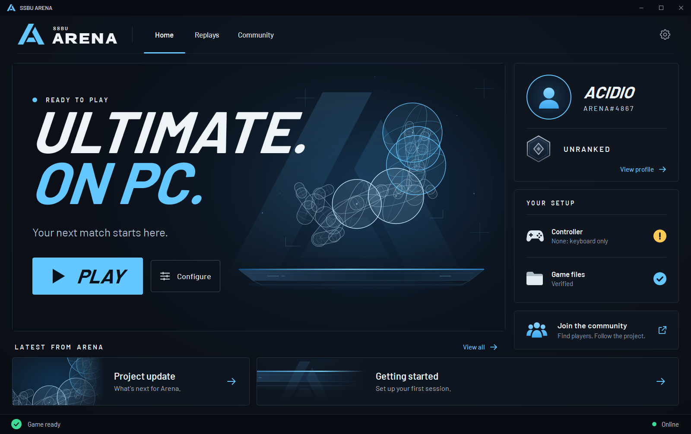

<div align="center">



# SSBU Arena

**Super Smash Bros. Ultimate on PC, built for competitive online play.**

Rollback netcode through a relay that never shows your address to anyone, a competitive 1v1 mode,
and one small launcher that sets everything up and keeps it up to date.

[](https://github.com/ssbuarena/ssbu-arena/releases/latest)
[](https://www.ssbuarena.com/)
[](LICENSE)


**[Download for Windows](https://github.com/ssbuarena/ssbu-arena/releases/latest/download/SSBU-Arena.exe)** ·
[Website](https://www.ssbuarena.com/) ·
[How rollback works](https://www.ssbuarena.com/rollback) ·
[Build from source](BUILDING.md)

</div>

> [!IMPORTANT]
> **This repository contains no game code, no game assets, no keys and no firmware.**
> You need your own legally obtained copy of the game (13.0.4 or 13.0.5). Everything derived from it is built on
> your PC, from your copy, and never leaves it.

> [!NOTE]
> SSBU Arena is based on **[OpenSmash-Ultimate](https://github.com/OpenSmash-Ultimate/ssbu-recomp)** by Denkishi and
> its contributors: the static recompilation, the runtime that replaces the console, the Vulkan renderer and the
> rollback snapshot ring come from there. Arena started as a fork of it and is now developed on its own. See
> [Credits](#credits).

## Get started

| You need | |
|---|---|
| **Windows 10 or 11, 64-bit** | A graphics card with a Vulkan 1.3 driver |
| **Your own copy of the game** | Update 13.0.4 or 13.0.5, with the keys and firmware from your own console. The setup finds them in the folders of the usual emulators |
| **About 25 GB free** | The game unpacked from your copy and the files built from it |
| **About 20 minutes, once** | The first setup builds the game for your PC. Updates afterwards take a few minutes |

1. **Download [`SSBU-Arena.exe`](https://github.com/ssbuarena/ssbu-arena/releases/latest/download/SSBU-Arena.exe)**
   and save it in a new, empty folder: SSBU Arena installs itself next to it.
2. **Open it.** The setup checks your PC, finds your game, keys and firmware, and builds Ultimate for your PC.
3. **Create your account** on [ssbuarena.com](https://www.ssbuarena.com/signup) and sign in from the launcher to play
   online. Then press **Play**.

> [!TIP]
> **Windows says "Windows protected your PC"?** SSBU Arena is a new app, so SmartScreen asks before its first start:
> choose **More info**, then **Run anyway**. If a double-click does nothing, right-click `SSBU-Arena.exe` >
> **Properties** > tick **Unblock** > **OK**, and open it again. It never needs to run as administrator.

Every time it starts, the launcher checks for a new release and updates itself and the game in place. Your saves and
settings stay.

## What Arena adds

| | Feature | State |
|---|---|---|
| 🌐 | **Rollback netcode online**: the game's own Local Wireless rooms played over the internet, with rollback instead of the game's delay-based netcode | Live |
| 🛡️ | **Relay-only server** ([`tools/net/rb_lobby.c`](tools/net/rb_lobby.c)): every packet goes through the server, no hole punching, no player ever learns another player's IP | Live |
| 📶 | **Ping on screen** in every online match, next to each player | Live |
| 🏆 | **Competitive mode**: the six legal stages (Battlefield, Small Battlefield, Final Destination, Pokémon Stadium 2, Smashville, Town and City), no items, no Final Smash meter, no hazards | Live |
| 🖥️ | **SSBU Arena launcher** ([`tools/launcher/arena`](tools/launcher/arena)): one-file download, guided setup, automatic updates, account sign-in, controllers, video and audio settings, shader preparation | Live |
| 🎮 | **Arena main menu**: Smash, Online LDN, Battle Arena, Online Matchmaking, Settings and Exit, with an in-game settings menu | Live |
| 💾 | **Light archive**: only what competitive 1v1 needs (8.8 of 16.4 GB) | Live |
| 👥 | Friends, invites and Arena lobbies | In development |
| 📈 | Automatic ranked 1v1 with skill-based ratings | In development |

The full roadmap is on [ssbuarena.com/project](https://www.ssbuarena.com/project).

## How it works

The game's AArch64 code is translated to C ahead of time and compiled into a native Windows program: no emulation.
The console's system libraries, graphics, audio, input and files are re-implemented, and the picture is drawn with
Vulkan.

```
your copy --> tools/extract --> main executable, SDK, script modules, data
                 |
        tools/lifter (recomp.py)     AArch64 -> C, one C function per game function
                 |
        clang --> game DLL + one DLL per script module
                 |
        runtime/                      what the console provided, re-implemented (threads, files, audio, input,
                                      movies, fonts, network), NVN graphics on Vulkan,
                                      rollback (r1_*.c, rb_*.c) and the online layer (net_relay.c)
```

Releases ship the launcher and a prebuilt runtime (our code only, audited for game content by
[`scripts/make_release.py`](scripts/make_release.py)); the game itself is always built on the player's PC.

## Build from source

Everything the launcher does can be done by hand:

```bash
git clone https://github.com/ssbuarena/ssbu-arena
```

Then follow **[BUILDING.md](BUILDING.md)** (Linux: [BUILDING_LINUX.md](BUILDING_LINUX.md), macOS:
[BUILDING_MAC.md](BUILDING_MAC.md)). Contributions are welcome: read **[CONTRIBUTING.md](CONTRIBUTING.md)** first.

## FAQ

**Is this legal?** The repository contains no game code, assets, keys or firmware, and does not help anyone obtain
them. You build the program on your PC from a copy of the game you own. This is not legal advice; laws differ by
country.

**Does it include the game?** No. Not the game, not the keys, not the firmware, and no links to them.

**Is my IP shared with the other player?** No. Every online packet goes through the Arena server; the other player only
sees a virtual address of the server's network.

**What data does SSBU Arena collect?** Only what an account and online play need. See the
[privacy policy](https://www.ssbuarena.com/privacy).

## Credits

SSBU Arena is made by **[Acid236](https://github.com/Acid236)**: online play through the relay server, rollback
netcode online, the ping overlay, the competitive mode and light archive, the Arena menu and the launcher.

It exists because of **[OpenSmash-Ultimate / ssbu-recomp](https://github.com/OpenSmash-Ultimate/ssbu-recomp)**.
Thank you to **Denkishi**, who created it and wrote most of it, and to its contributors: **Stephen Jayakar**,
**xtlg511**, **v1Ta44**, **Frank Fly**, **Victor Navega** and **jfb112697**. The full history of their work is kept in
this repository's git history. Details, and the open-source projects both projects build on, are in
**[CREDITS.md](CREDITS.md)**.

## Legal and license

SSBU Arena is not affiliated with, endorsed or sponsored by Nintendo, Bandai Namco or Sora Ltd. *Super Smash Bros.* and
*Nintendo Switch* are trademarks of their owners and are named only to say what the software works with. The
repository contains no copyrighted game data, no console keys and no firmware, and does not help anyone obtain them.
**You must own the game and dump it yourself.** No Nintendo logos or artwork are used.

Licensed under the GNU General Public License, version 3 or later, the same as OpenSmash-Ultimate (see
[LICENSE](LICENSE)). Files keep their original copyright and license notices.
